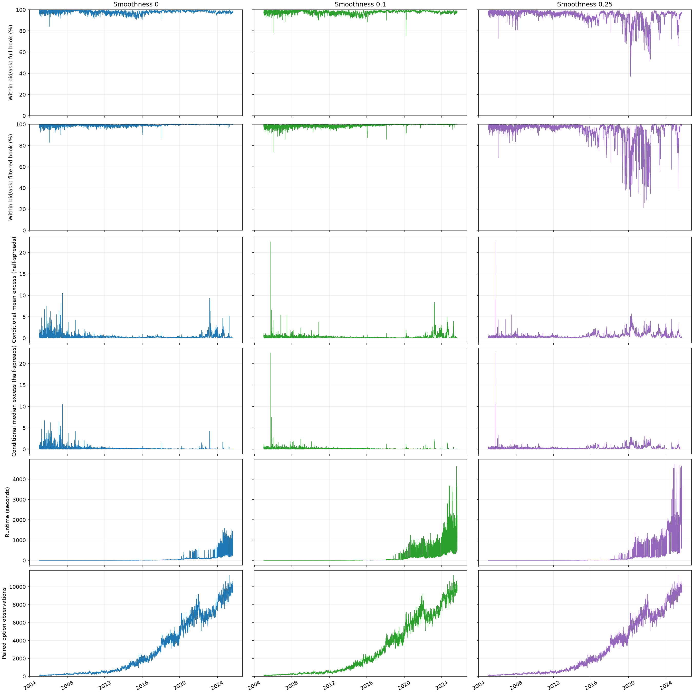
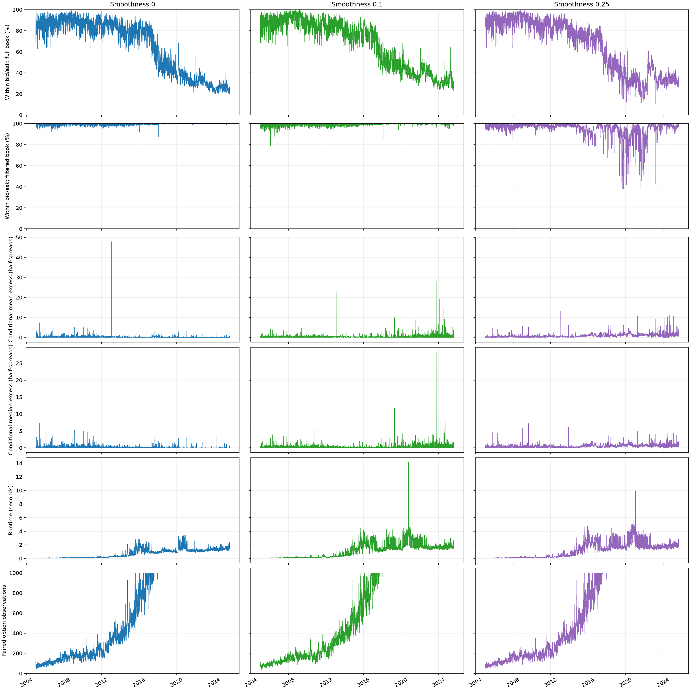

# SANOS historical fits

Completed 5,151 SPX dates from 2005-01-03 to 2025-08-29; both populations at smoothness 0, 0.1 and 0.25.

Everything fits all reasonable paired observations after raw and expiry validation. The filtered dataset first performs full-book linear cleaning, applies the paper eligibility criteria and 1,000-row cap, then fits a separate SANOS surface. All saved models passed an independent post-repair audit of density bounds, mass, forward mean, calendar and original quote-LP constraints at 1e-5. Recovery checks 1e-7 first.

Two ticker-level historical day exclusions, 2006-11-17 and 2015-08-21, use previously reconstructed, retained observations. These date-scope overrides are recorded in the public provenance; licensed input paths remain outside Git.

| Population | Smoothness | Dates | Mean daily within bid/ask | Mean daily conditional excess | Median daily conditional median | Median runtime (s) |
|---|---:|---:|---:|---:|---:|---:|
| all | 0 | 5,151 | 97.9293% | 0.371128 | 0.123896 | 6.458 |
| all | 0.1 | 5,151 | 97.6819% | 0.284828 | 0.117361 | 9.769 |
| all | 0.25 | 5,151 | 94.0571% | 0.615790 | 0.209612 | 9.787 |
| flt | 0 | 5,151 | 99.4770% | 0.178039 | 0.000000 | 0.663 |
| flt | 0.1 | 5,151 | 99.0928% | 0.352947 | 0.119839 | 1.150 |
| flt | 0.25 | 5,151 | 95.0397% | 0.774698 | 0.359810 | 1.215 |

The isolated runtime recovery adapter starts with Clarabel at 600 seconds and retries unsuccessful solves at 3,000 seconds. Feasible native iterates are checked at 1e-7 before permitting 1e-5, then the original density repair and an independent post-repair audit are applied. Acceptance proves numerical feasibility, not optimality. An infeasible preliminary hard bid/ask helper LP does not imply that the final soft-fitting problem is infeasible. Each input population is evaluated without dropping internally masked strikes.

Conditional excess is measured in half-spreads for options outside the original bid/ask; a day with no excess records zero. Runtime is the sum of the recorded per-expiry and surface fitting times. It excludes enrichment, fitted-row packing, model serialization and the independent feasibility audit; audited wall time is retained separately in the licensed source statistics. All requested dates were processed before refreshing these figures.

Each column shows one smoothness level. Dates and each metric’s vertical scale are shared across columns. The first two rows report the same saved model’s bid/ask coverage on the full eligible book and on the filtered book, respectively. The filtered model evaluates other maturities using its usual interpolation and extrapolation; 0.50% of full-book observations across the three smoothness levels fall outside the fitted maturity range. Conditional errors and option counts refer to each model’s input population. Each counted paired strike/expiry observation corresponds to a call and put in the public extract.

### Fitting to all options*

The full eligible book consists of paired observations that pass the [default raw-quote and expiry-validation pipeline](docs/market-data.md#1-default-cleaning-before-the-linear-fit); it has no subsequent 1,000-option selection.

### Fitting to 1000 filtered options*

After the default cleaning and a full-book linear fit, the [eligible-option filter](docs/market-data.md#3-separate-eligible-option-filter-and-1000-row-cap) retains options with at most 756 business days to expiry, ATM-based NMS5 between -5 and 2, combined volume and open interest each at least 9, and at least 10 eligible strikes per expiry. It retains AM and PM options and caps the selection at 1,000 paired observations, prioritizing strikes near ATM while reserving strikes per expiry. The smooth surface is then fitted to that selection.

Filtering mainly improves speed: at smoothness 0.25, median fit time falls from 9.79 seconds for the full book to 1.22 seconds for the filtered book. On the same filtered options, mean daily bid/ask coverage rises modestly from 93.64% for the full-book model to 95.04% for the filtered model. Individual days can differ much more: on 11 April 2025, the corresponding 0.25 fits cover 39.1% and 90.9%, respectively.

Licensed observations, caches, models and diagnostics remain outside Git.

## Solver attempt statuses

<table>
  <thead>
    <tr><th rowspan="2">Population, smoothness</th><th rowspan="2">Failures</th><th rowspan="2">Dates below 90% within bid/ask</th><th colspan="4">Reported intermediate issues (solver attempts)</th></tr>
    <tr><th>Time limit</th><th>Clarabel numerical error</th><th>Insufficient progress</th><th>Iteration limit</th></tr>
  </thead>
  <tbody>
  <tr><td>all, 0</td><td>0</td><td>1</td><td>0</td><td>6</td><td>2</td><td>0</td></tr>
  <tr><td>all, 0.1</td><td>0</td><td>6</td><td>31</td><td>334</td><td>30</td><td>0</td></tr>
  <tr><td>all, 0.25</td><td>0</td><td>731</td><td>60</td><td>618</td><td>22</td><td>0</td></tr>
  <tr><td>flt, 0</td><td>0</td><td>2</td><td>0</td><td>0</td><td>0</td><td>0</td></tr>
  <tr><td>flt, 0.1</td><td>0</td><td>5</td><td>0</td><td>0</td><td>0</td><td>0</td></tr>
  <tr><td>flt, 0.25</td><td>0</td><td>613</td><td>0</td><td>1</td><td>0</td><td>0</td></tr>
  </tbody>
</table>

Failures counts dates without a completed, audited final fit. Reported intermediate issues count native LP attempts, including retries and preprocessing; they are not counts of failed daily models. A numerical-error attempt is one for which Clarabel stopped because of numerical difficulty. Of the 959 such attempts, 604 returned an iterate that passed the linear-constraint and bound checks and was accepted; the other 355 attempts were not accepted, and their daily fits subsequently passed through another recovery path. An accepted feasible iterate does not imply optimality. Preliminary hard bid/ask helper infeasibility is a normal branch into the soft fit and is excluded from this table. All six final datasets have complete, independently certified daily fits; no unresolved daily fits remain.
