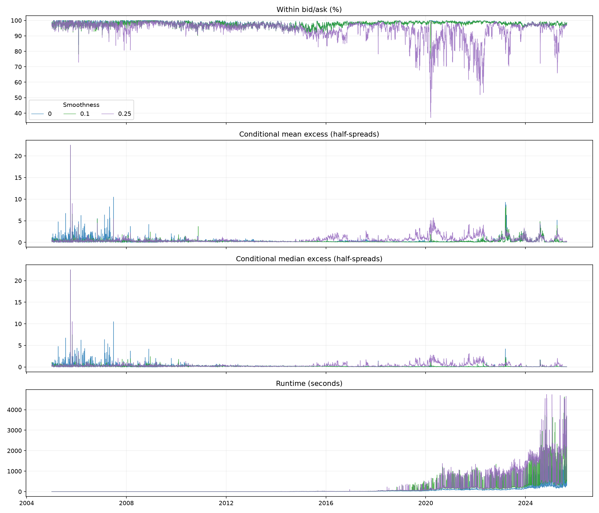
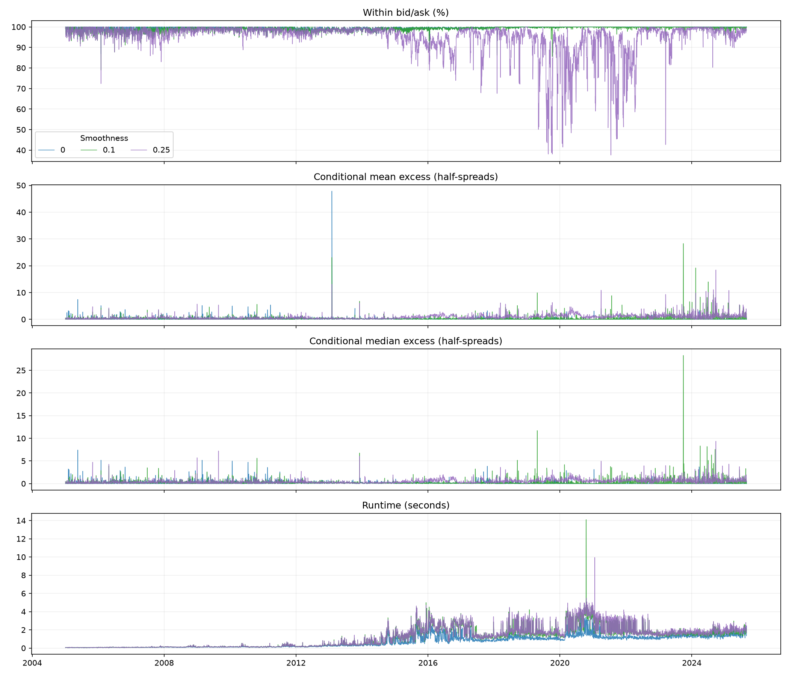

# SANOS historical fits

Completed 5,151 SPX dates from 2005-01-03 to 2025-08-29; both populations at smoothness 0, 0.1 and 0.25.

Everything fits all reasonable paired observations after raw and expiry validation. The filtered dataset first performs full-book linear cleaning, applies the paper eligibility criteria and 1,000-row cap, then fits a separate SANOS surface. All saved models passed an independent post-repair audit of density bounds, mass, forward mean, calendar and original quote-LP constraints at 1e-5. Recovery checks 1e-7 first.

Two ticker-level historical day exclusions, 2006-11-17 and 2015-08-21, use previously reconstructed, retained observations. These date-scope overrides are recorded in the public provenance; licensed input paths remain outside Git.

| Population | Smoothness | Dates | Mean daily within bid/ask | Mean daily conditional excess | Median daily conditional median | Median runtime (s) |
|---|---:|---:|---:|---:|---:|---:|
| all | 0 | 5,151 | 97.9293% | 0.371128 | 0.123896 | 6.458 |
| all | 0.1 | 5,151 | 97.6819% | 0.284828 | 0.117361 | 9.769 |
| all | 0.25 | 5,151 | 94.0571% | 0.615790 | 0.209612 | 9.787 |
| flt | 0 | 5,151 | 99.4770% | 0.178039 | 0.000000 | 0.663 |
| flt | 0.1 | 5,151 | 99.0928% | 0.352947 | 0.119839 | 1.150 |
| flt | 0.25 | 5,151 | 95.0397% | 0.774698 | 0.359810 | 1.215 |

The isolated runtime recovery adapter starts with Clarabel at 600 seconds and retries unsuccessful solves at 3,000 seconds. Feasible native iterates are checked at 1e-7 before permitting 1e-5, then the original density repair and an independent post-repair audit are applied. Acceptance proves numerical feasibility, not optimality. An infeasible preliminary hard bid/ask helper LP does not imply that the final soft-fitting problem is infeasible. Each input population is evaluated without dropping internally masked strikes.

Conditional excess is measured in half-spreads for options outside the original bid/ask; a day with no excess records zero. Runtime is the sum of the recorded per-expiry and surface fitting times. It excludes enrichment, fitted-row packing, model serialization and the independent feasibility audit; audited wall time is retained separately in the licensed source statistics. All requested dates were processed before refreshing these figures.

The [benchmark extraction pipeline](src/quantdata/benchmark_data/widb/PUB_PIPELINE.md) documents source configurations, units and regeneration. Licensed observations, caches, models and diagnostics remain outside Git. Validated public extracts and configuration/version metadata are retained under `benchmark_data/widb/` with Parquet data in Git LFS.

## Solver attempt statuses

| Population | Smoothness | Time limit | Numerical error | Insufficient progress | Iteration limit | Dates below 90% within bid/ask |
|---|---:|---:|---:|---:|---:|---:|
| all | 0 | 0 | 6 | 2 | 0 | 1 |
| all | 0.1 | 31 | 334 | 30 | 0 | 6 |
| all | 0.25 | 60 | 618 | 22 | 0 | 731 |
| flt | 0 | 0 | 0 | 0 | 0 | 2 |
| flt | 0.1 | 0 | 0 | 0 | 0 | 5 |
| flt | 0.25 | 0 | 1 | 0 | 0 | 613 |

These are counts of native LP attempts, including retries and preprocessing, not counts of failed daily models. Preliminary hard bid/ask helper infeasibility is a normal branch into the soft fit and is excluded from this table. All six final datasets have complete, independently certified daily fits; no unresolved daily fits remain.
