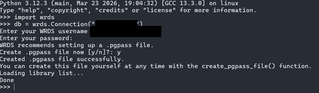
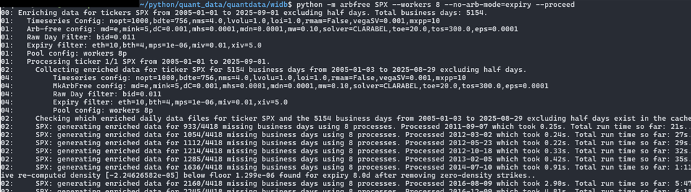

# WIDB: WRDS OptionMetrics IvyDB

`openqdata.widb` gives cached access to OptionMetrics IvyDB US through WRDS. The OptionMetrics observations, and every cache derived from them, are **licensed data**. Keep them outside Git.

```python
from openqdata.widb import WIDBClient
client = WIDBClient()
```

## Access

1. [Configure the storage locations](../getting-started.md#storage-locations).
2. [Create a WRDS account](https://wrds-www.wharton.upenn.edu/pages/support/getting-started/) and [enable MFA](https://wrds-www.wharton.upenn.edu/pages/about/log-in-to-wrds-using-two-factor-authentication/).
3. Create the libpq `.pgpass` file, following the [WRDS Python instructions](https://wrds-www.wharton.upenn.edu/pages/support/programming-wrds/programming-python/python-from-your-computer/). On Python 3.12 and 3.13, running `import wrds; wrds.Connection()` once guides you through it:

   

4. Set `WRDS_USERNAME` to your account name. Setting `WRDS_OFF=1` disables live access.
5. Run [`notebooks/viz_client.ipynb`](../../src/openqdata/widb/notebooks/viz_client.ipynb) to check the connection.

WRDS allows a limited number of concurrent connections per account. **Use at most four download processes.**

### Python 3.14

The vendor `wrds` SDK pins a pandas release that does not work on Python 3.14. On 3.14, `WIDBClient` instead uses a small SQLAlchemy/PostgreSQL transport (`connection.py`) with the same `raw_sql`, `list_libraries` and `list_tables` methods.

- Authentication uses `.pgpass` or `PGPASSFILE`.
- Connections use TLS and the standard WRDS endpoint. `PGHOST`, `PGPORT` and `PGDATABASE` can override the endpoint.
- The SDK's interactive password wizard isn't available, so create `.pgpass` beforehand.

## Client

| Method | Returns |
|---|---|
| `credentials()`, `connect()` | WRDS credentials from the environment, and a lazily opened, shared connection. The connection resolves the account's OptionMetrics library and table names. |
| `ticker_to_secid_map()`, `lookup_secid()`, `lookup_ticker()` | Mappings between tickers such as `SPX` and OptionMetrics security IDs. |
| `options(secid, date)` | Raw option quotes for one security and date. |
| `spot_price(secid, date)` | Underlying close. |
| `forwards(secid, date)` | OptionMetrics forward prices. |
| `zero_curve(date)` | USD zero-coupon curve. Use `interpolate_zero_curve(curve, days)` for discount factors at given expiries. |

Every fetch is cached in the `widb` raw location, so later stages run from local copies. See the [IvyDB reference manual](https://wrds-www.wharton.upenn.edu/documents/1995/IvyDB_US_v6.0_Reference_Manual.pdf) for table definitions.

## Processing

The daily pipeline is built on this client:

- `collect_raw_day` cleans one day of quotes.
- `enrich_day` adds implied forwards, normalized prices and Greeks.
- `mk_arb_free_day` fits a linear arbitrage-free surface.
- `filter_options_day` selects eligible options.
- `build_time_series` packs many days into arrays.

The [WIDB benchmark data](../widb-benchmark/pipeline.md) page documents each stage, its defaults and Python examples. The result is cleaned quotes with an arbitrage-free interpolation.

Batch commands download and process a date range:

```sh
python -m openqdata.widb.day SPX --period 2025-06-01 2025-09-01 --workers 4
python -m openqdata.widb.arbfree SPX --period 2025-06-01 2025-09-01 --workers 4 --proceed
```

With `--proceed`, the run continues past numerical errors on individual days.


